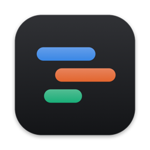
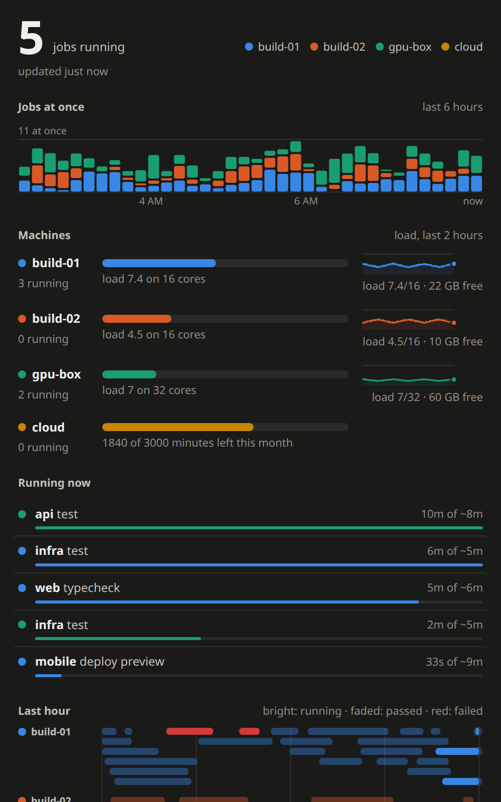

<p align="center"></p>

<h1 align="center">Lanes</h1>

<p align="center">Every GitHub Actions job on every one of your machines, in your Mac's menu bar.</p>

If you run self-hosted runners on more than a couple of machines, GitHub shows you one repo at a time. Lanes shows
you all of it at once: what each machine is running right now, how busy it is, what just failed, and how the last
six hours went.

<p align="center"></p>

- **The menu bar glyph** is a set of tiny lanes, one per machine, each as long as the number of jobs running there,
  with the total beside it. A red dot means a job failed in the last 30 minutes.
- **Click it** for the panel:
  - jobs at once over the last 6 hours, by machine
  - each machine's load, with a 2-hour sparkline
  - every running job, with a bar showing how far along it is against that job's usual time
  - a timeline of the last hour, with a lane per machine
  - a tile for every job that finished in the last 6 hours

  Hover anything for details, and click a job to open it on GitHub.
- **It only reads.** Lanes never starts, stops or changes a runner, and its server listens on 127.0.0.1 unless you
  tell it otherwise.

## How it works

```
 Mac                         hub machine                          other machines
┌────────────┐  SSH tunnel  ┌──────────────────────────┐   SSH    ┌─────────────────────┐
│ Lanes.app  │ ───────────▶ │ lanes hub (127.0.0.1:8792)│ ──────▶ │ lanes agent         │
│ menu bar   │              │ page + /status.json       │         │ reads runner logs   │
└────────────┘              └──────────────────────────┘          └─────────────────────┘
```

- `lanes agent` reads one Linux machine. It finds GitHub runners installed as systemd services (what `svc.sh
  install` sets up), reads their output from the system journal ("Running job: …", "Job … completed with result:
  …"), and adds load and free memory. It prints JSON and exits. Its user needs to read the journal: be in the
  `systemd-journal` (or `adm`) group, or no jobs show. The installer says so if you aren't.
- `lanes hub` runs the agent on every machine in its config every 5 seconds: itself directly, the others over SSH.
  It serves the panel page and the merged data.
- The Mac app shows that page in a panel and draws the glyph from the same data.

The server is one Python file (3.11+, standard library only). The app is one Swift file.

## Set up

**1. Every machine with runners** (Linux with systemd, Python 3.11+). Clone this repo and install the `lanes`
command:

```sh
git clone https://github.com/hunterbohm/lanes && lanes/server/install.sh
```

**2. One machine as the hub.** It can be one of the runner machines. It needs SSH access, without a password prompt,
to the others:

```sh
lanes/server/install.sh --hub          # a systemd user service, and ~/.config/lanes/hub.toml to edit
$EDITOR ~/.config/lanes/hub.toml       # list your machines (see server/hub.example.toml)
systemctl --user restart lanes
```

Open `http://127.0.0.1:8792/` on the hub, or `curl` it, to check.

**3. Your Mac** (macOS 13+, Xcode command line tools):

```sh
git clone https://github.com/hunterbohm/lanes && lanes/app/build.sh --install --tunnel HUB
```

This builds `~/Applications/Lanes.app`, starts it at login, and keeps an SSH tunnel to `HUB` (anything `ssh HUB`
accepts), so the app's default address `http://127.0.0.1:8792/` reaches the hub. If the Mac can reach the hub
directly instead (say, over a VPN with `listen` set), skip `--tunnel`. Then right-click the glyph, choose **Server
Address…**, and enter the hub's address.

### Try it without a fleet

```sh
python3 lanes/server/lanes demo        # made-up machines and jobs on http://127.0.0.1:8792/
```

## Using it

- **Click the glyph** to open the panel. Esc or a click outside closes it.
- **Right-click** for Refresh, Open in Browser, Server Address… and Quit.
- **`open lanes://toggle`** (or `lanes://show`, `lanes://hide`) opens and closes it from a hotkey tool. A
  click from a custom bar that presses menu bar items through Accessibility, with the macOS menu bar hidden, opens
  the panel under the pointer.

## Adding your own data

Runners that aren't systemd services, cloud runners, or a job queue of your own can be added with **sources**:
commands the agent runs, listed in `~/.config/lanes/agent.toml` on that machine. Each runs through the shell as the
agent's user, like a crontab line, and gets 30 seconds:

```toml
# runner_services = false   # skip systemd runner discovery
sources = ["~/bin/my-lanes-source"]
```

A source prints one JSON object. Every key is optional:

```jsonc
{
  "jobs": [      // running now
    {"repo": "acme/api", "job": "test", "state": "running", "since": 1767225600,
     "label": "vm-4cpu", "url": "https://github.com/acme/api/actions", "size": "default",
     "machine": "cloud"}            // omit `machine` for this machine; name another to show it there
  ],
  "recent": [    // finished; shown for 6 hours
    {"repo": "acme/api", "job": "lint", "result": "success", "started": 1767225000, "finished": 1767225300}
  ],
  "slots": {"used": 8, "total": 16, "label": "VM CPUs"},       // drawn as blocks instead of the load bar
  "note": "draining for a restart",
  "machines": [  // machines this one reports for, such as a cloud provider
    {"name": "cloud", "meter": {"label": "minutes left this month", "value": 1840, "max": 3000}}
  ]
}
```

`state` is `running` or `starting`. `result` is `success`, `failure` or `cancelled`. Times are Unix seconds.
Only `http(s)` links are kept.

## Notes

- The data the hub serves includes your repo and job names. Keep it on `127.0.0.1` and reach it through SSH, as
  above, unless your network is private. It answers only requests addressed to `127.0.0.1`, `localhost`, its
  `listen` address, or a name listed in `hosts`, so a web page can't read it by pointing its own domain at your
  machine.
- Runs are matched to their usual time by repo and job name, using successful runs from the last 6 hours.
- Load samples are kept for 2 hours in `~/.local/state/lanes/samples.json` on the hub.
- The page also works on its own in any browser. To show it in an iframe inside another app, load `/?in=embed`.
  It then leaves the background to its host and posts `{type: "lanes-height", height}` and
  `{type: "lanes-close"}` (on Esc) to the parent window.
- The app allows plain-HTTP loads because the hub speaks plain HTTP. Nothing else is loaded.

## License

MIT
